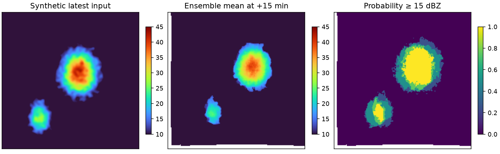

# mojoSTEPS

[](https://github.com/mblsha/mojoSTEPS/actions/workflows/ci.yml)

A standalone **Mojo/MAX forecast core** for a fixed configuration of the
[pySTEPS](https://pysteps.github.io/) STEPS stochastic precipitation nowcast.
CPU and Apple Metal GPU backends execute the forecast without Python. A small
Python interface prepares arrays, runs a synthetic demo and checks results
against pySTEPS 1.21.2. A [C example](examples/forecast.c) calls the same core.

**Research release 0.1.0.** This ports one configuration, rather than the full
pySTEPS library. It has numerical parity tests; forecast skill on real storms
and operational reliability require separate evaluation.



## Quick start

Requires [uv](https://docs.astral.sh/uv/getting-started/installation/), Git,
a C++17 compiler (Xcode Command Line Tools on macOS), and a supported Mojo host:
Apple silicon macOS or Linux x86-64 with AVX2 / x86-64-v3.
For the macOS pySTEPS reference install, run `brew install llvm libomp` first. The GPU backend is
qualified on Apple M1 Ultra and M5 Ultra; CUDA/ROCm and Intel Macs are untested
by this project. See [hardware and installation](docs/INSTALL.md).

```sh
git clone https://github.com/mblsha/mojoSTEPS.git
cd mojoSTEPS
sh scripts/bootstrap.sh
.venv/bin/python scripts/build.py --backend cpu
OMP_NUM_THREADS=1 OPENBLAS_NUM_THREADS=1 VECLIB_MAXIMUM_THREADS=1 \
  .venv/bin/python -m mojosteps demo --compare
```

Open `.build/demo/preview.png`. The demo writes synthetic input and forecast
arrays, a raw C input file, and a JSON receipt with timing, input/output hashes,
source identities and numerical errors. It uses no downloaded radar data.

On Apple silicon:

```sh
.venv/bin/python scripts/build.py --backend all
.venv/bin/python -m mojosteps demo --backend gpu --compare --output .build/demo-gpu
MOJOSTEPS_TEST_GPU=1 .venv/bin/python -m pytest -q
```

The GPU backend keeps fitting, RNG, FFT/cascades, ensemble evolution, CDF
matching, masking and advection on Metal, with a final output readback. CPU
validation, allocation, launch scheduling and final conversion remain. `workers=1`
is supported; it limits application parallelism, not OS scheduling or driver threads.

## Supported configuration

| Contract | Value |
| --- | --- |
| Input | Three 192 × 192 dBZ fields, oldest first |
| Motion | Two 192 × 192 fields: x/y pixels per five-minute step |
| Ensemble / horizon | 1–96 members; 1–14 leads (+5 through +70 min) |
| Scale | 0.5 km pixels; 5 min timesteps |
| Model | Six Gaussian cascades; nonparametric noise; AR(2) |
| Postprocessing | Incremental mask; empirical CDF matching |
| Motion perturbation | BPS |
| Rain threshold / no rain | 10 / −10 dBZ |
| Arithmetic | CPU float64; GPU paired float32 (~48 significant bits) |
| Output | float64 [member, lead, y, x]; NaN outside advected domain |

```python
from mojosteps import Forecast
from mojosteps.synthetic import rain_cells
history, velocity = rain_cells()
forecast = Forecast("cpu").forecast(history, velocity, 14, members=96, workers=1)
```

Input motion dtype matters: float32 and float64 follow the corresponding pySTEPS
interpolation semantics. Fewer than 16 rain pixels across all history fields
uses latest-field persistence. Degenerate models are rejected. See [API](docs/API.md)
for validation, units, thread safety, memory and the C ABI.

## Evidence and reproducibility

The acceptance contract is identical finite masks, ≤ `1e-5 dBZ` maximum error
on finite values, and identical decisions at 10/15/20 dBZ after float32 conversion.
This is numerical agreement, not a promise of bitwise equality to pySTEPS.
[Reproduction commands and benchmark methodology](docs/REPRODUCIBILITY.md)
separate hosted CPU CI from real-hardware GPU checks. Public receipts use only
the included synthetic generator. See [benchmark results](docs/BENCHMARKS.md) and the
[matched FFTW/PocketFFT comparison](docs/FFT_COMPARISON.md).
[Measured RAM and Metal resource use](docs/MEMORY.md) covers the same full workload.

CPU CI builds and tests on Linux and macOS. GPU CI is an opt-in manual workflow
for an owner-provisioned Apple runner; hosted CPU success does not certify GPU
execution. The included hardware receipts document actual Metal runs.

Read the [architecture](docs/ARCHITECTURE.md), [contributing guide](CONTRIBUTING.md)
and [changelog](CHANGELOG.md). To cite this software, use [CITATION.cff](CITATION.cff)
and also cite the [pySTEPS paper](https://doi.org/10.5194/gmd-12-4185-2019).

## License

mojoSTEPS source is **BSD-3-Clause**, with retained pySTEPS, NumPy/RandomKit and
PocketFFT notices. The CPU FFT bridge uses BSD PocketFFT; FFTW is not required.
**Mojo/MAX remains an external dependency under its own terms.** This release
ships source, not SDK/runtime binaries or prebuilt native wheels. Read
[LICENSE](LICENSE), [NOTICE](NOTICE) and [dependency licensing](docs/LICENSING.md).
